# Examples

Generated by `make_examples.py`. Gold = side to move, grey = opponent. Green bars are the mover's
groups, red bars the opponent's (thicker = more valuable); dashed rings mark each group's empty
completion cells; the green ring is the recommended landing cell.

## Tactics the group explainer is built for

### Three in a row: complete the four

`c4shap 152537 --explainer groups` &nbsp; (position `horizontal_three`)

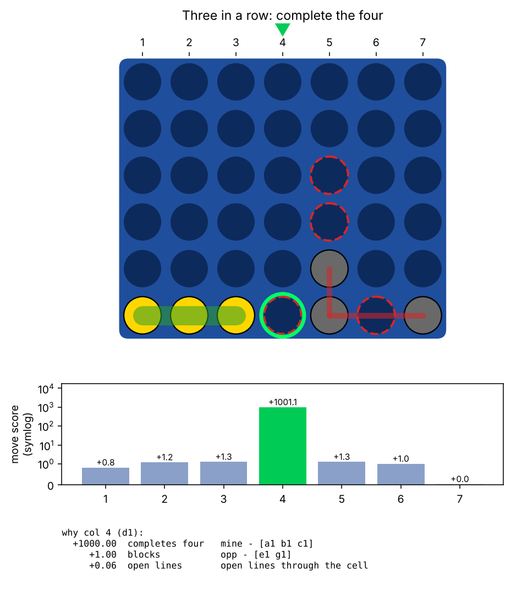

X holds a1 b1 c1. The group's only completion cell, d1, is playable, so the move that finishes the group wins on the spot. Playing there also kills O's e1 pair.

- group explainer: column 4 (d1), score +1001.1
- exact solver: column(s) 4 - side to move wins on ply 7 (1 of its own moves from now)
- the explainer agrees with the solver

### Vertical three

`c4shap 121212 --explainer groups` &nbsp; (position `vertical_three`)

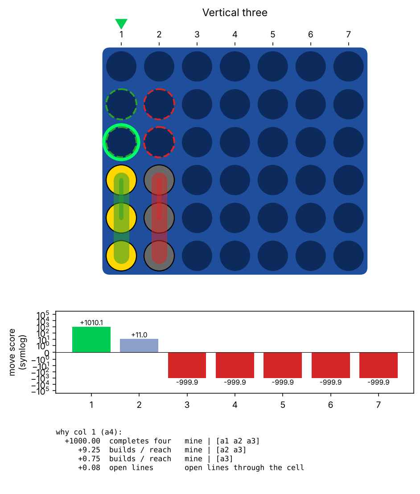

X stacks a1 a2 a3 while O answers in column 2. Column 1 completes the vertical group. The runner-up, column 2, is just the block of O's own vertical three.

- group explainer: column 1 (a4), score +1010.1
- exact solver: column(s) 1 - side to move wins on ply 7 (1 of its own moves from now)
- the explainer agrees with the solver

### A gapped three counts too

`c4shap 152547 --explainer groups` &nbsp; (position `gapped_three`)

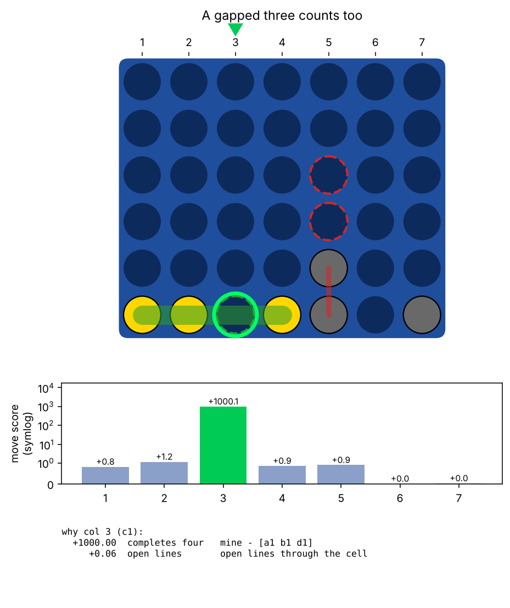

X has a1 b1 _ d1: not contiguous, but all three stones share one live window, so it is one group and c1 completes it.

- group explainer: column 3 (c1), score +1000.1
- exact solver: column(s) 3 - side to move wins on ply 7 (1 of its own moves from now)
- the explainer agrees with the solver

### Rising diagonal three

`c4shap 1344343225 --explainer groups` &nbsp; (position `diagonal_three`)

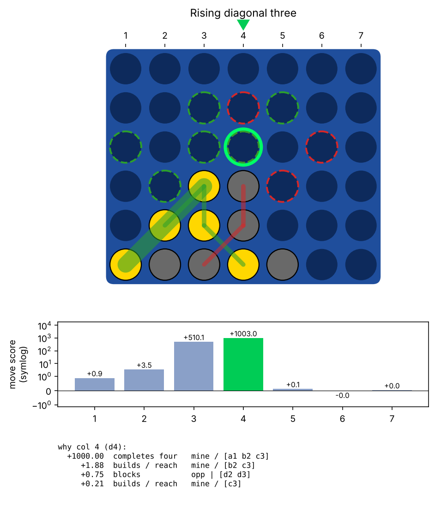

X holds b2 c3 and a supporting a1, and d4 is playable: the diagonal group a1-b2-c3 completes there.

- group explainer: column 4 (d4), score +1003.0
- exact solver: column(s) 4 - side to move wins on ply 11 (1 of its own moves from now)
- the explainer agrees with the solver

### Falling diagonal three

`c4shap 4335665334 --explainer groups` &nbsp; (position `diagonal_three_falling`)

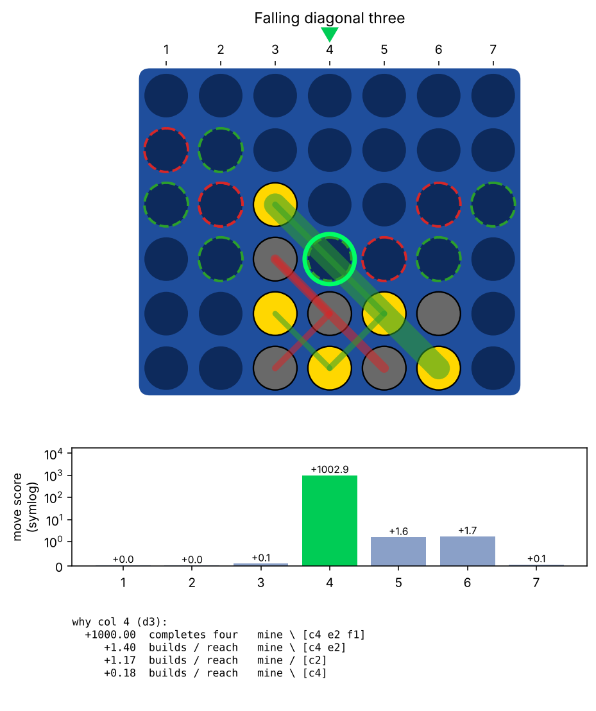

Same idea along the other diagonal: the group's completion cell has just become playable.

- group explainer: column 4 (d3), score +1002.9
- exact solver: column(s) 4 - side to move wins on ply 11 (1 of its own moves from now)
- the explainer agrees with the solver

### Block the opponent's three

`c4shap 152617 --explainer groups` &nbsp; (position `must_block`)

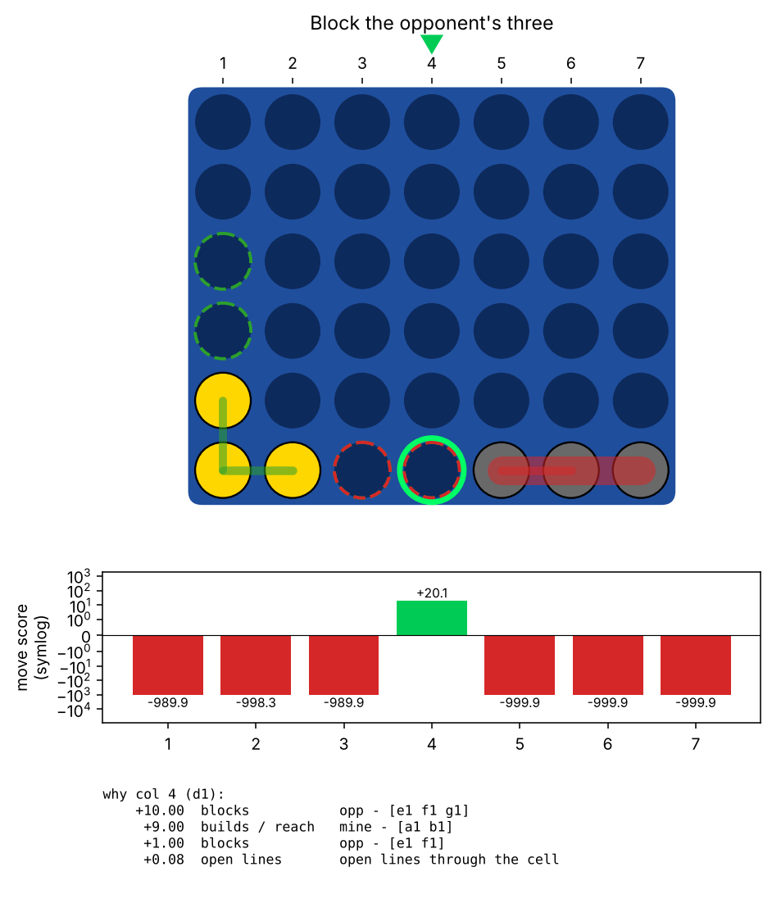

O holds e1 f1 g1 and threatens d1. X has no win, so the best move is the one that removes the most opponent group value: column 4. Column 1 looks natural for X but leaves the threat unblocked.

- group explainer: column 4 (d1), score +20.1
- exact solver: column(s) 4 - side to move wins on ply 37 (16 of its own moves from now)
- the explainer agrees with the solver

### Open two becomes an unstoppable three

`c4shap 2737 --explainer groups` &nbsp; (position `double_threat`)

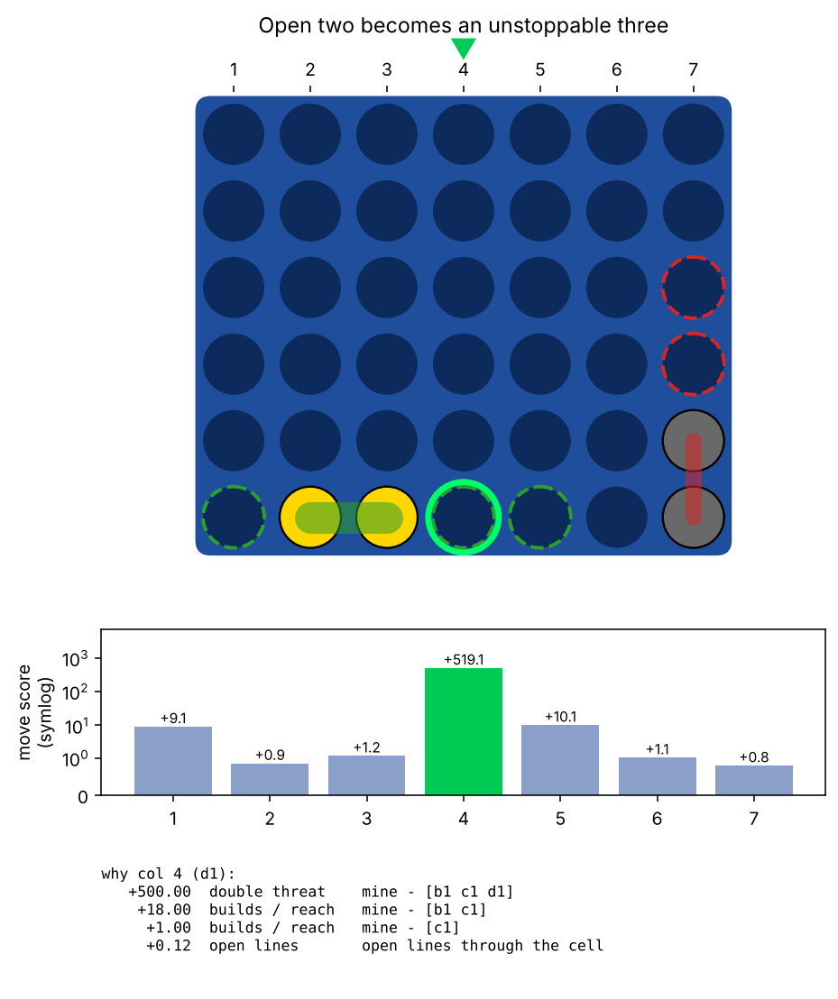

X has b1 c1. Playing d1 makes b1-c1-d1 with both a1 and e1 playable: two completion cells, one move to block them. The explainer scores this as a double threat.

- group explainer: column 4 (d1), score +519.1
- exact solver: column(s) 4 - side to move wins on ply 7 (2 of its own moves from now)
- the explainer agrees with the solver

### The tempting move that hands over the win

`c4shap 336224143 --explainer groups` &nbsp; (position `poisoned_square`)

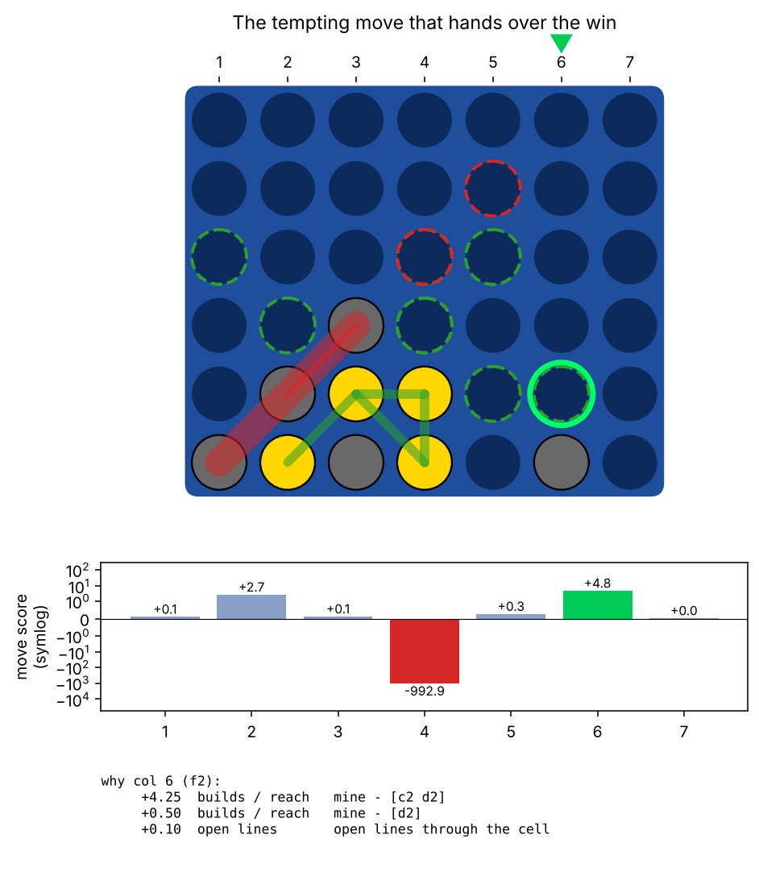

Playing d3 would make a vertical three (+9 group value) but opens d4, the completion cell of O's diagonal a1-b2-c3. The explainer charges that move -1000 against O's diagonal group and recommends column 6 instead (also winning; the solver prefers column 2).

- group explainer: column 6 (f2), score +4.8
- exact solver: column(s) 2 - side to move wins on ply 36 (14 of its own moves from now)
- the explainer **disagrees** with the solver

## Positions where the solver sees more

### A forced block that is also the only win

`c4shap 463644555 --explainer groups` &nbsp; (position `forced_block_wins`)

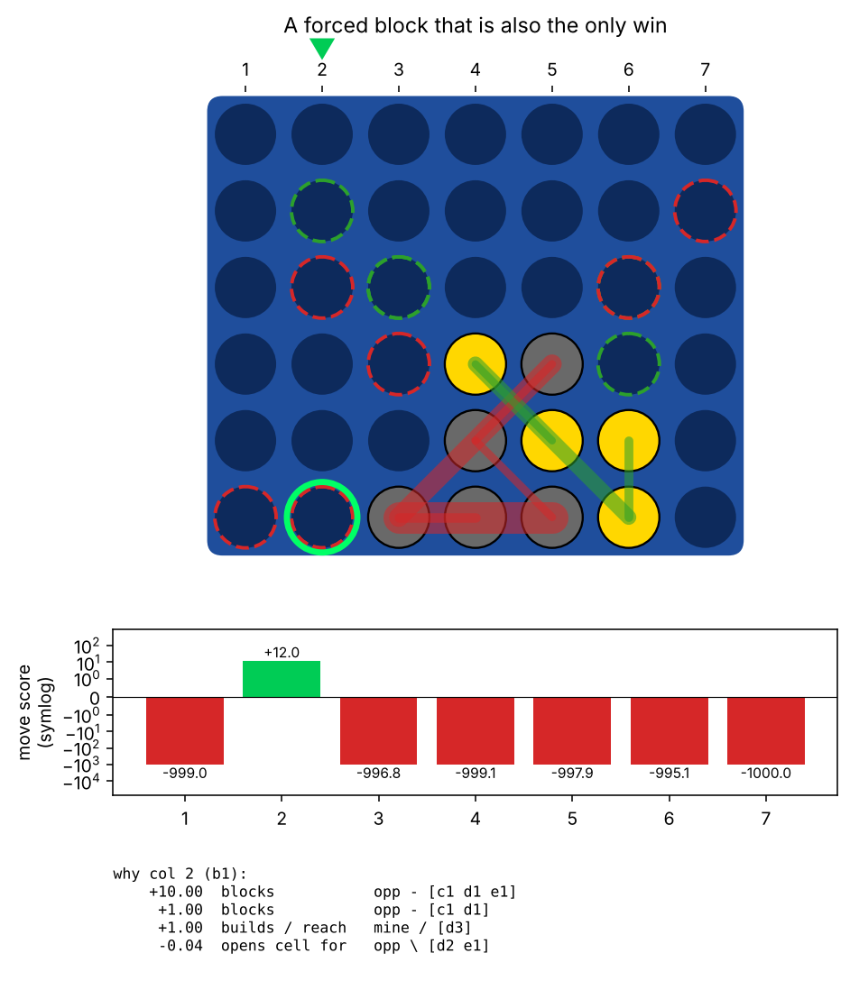

O threatens b1, so X must block there. Every other move loses at once, yet the block itself leads to a win on ply 40. A heuristic that only 'blocks' finds the move; only the solver knows it wins.

- group explainer: column 2 (b1), score +12.0
- exact solver: column(s) 2 - side to move wins on ply 40 (16 of its own moves from now)
- the explainer agrees with the solver

### One quiet move wins; six lose

`c4shap 7356536662322 --explainer groups` &nbsp; (position `quiet_only_move`)

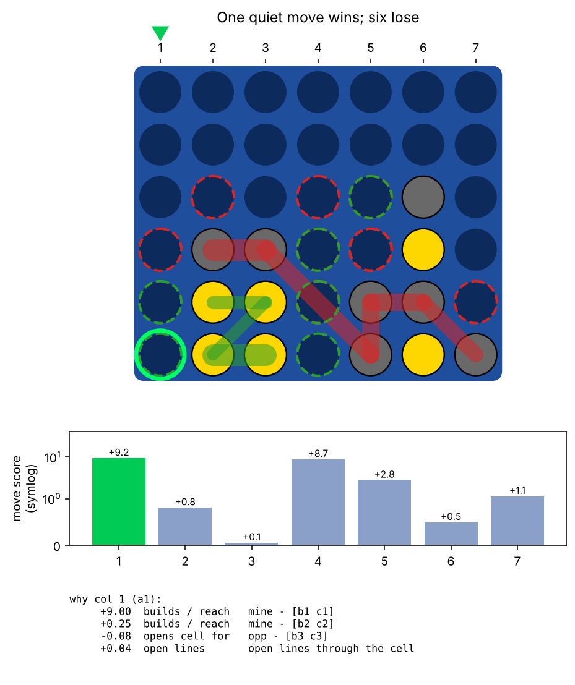

No immediate tactics, yet only column 4 does not lose (a win by a single point of score, on the last ply). The explainer picks column 1, which the solver says loses.

- group explainer: column 1 (a1), score +9.2
- exact solver: column(s) 4 - side to move wins on ply 42 (15 of its own moves from now)
- the explainer **disagrees** with the solver

### A win that only arrives on ply 40

`c4shap 7246715413571 --explainer groups` &nbsp; (position `late_squeeze`)

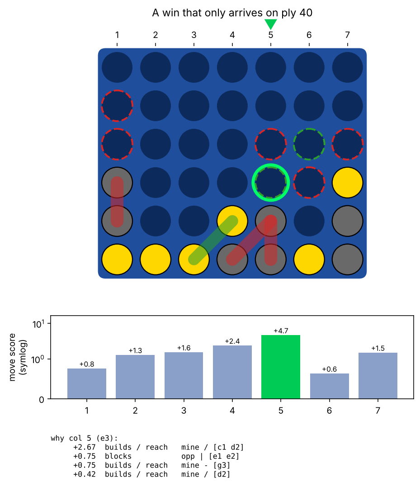

Only column 3 wins, and not until the board is nearly full, so the result hinges on who runs out of safe moves first. A one-move-ahead heuristic cannot see that; the solver proves it. The explainer picks column 5, which the solver says loses.

- group explainer: column 5 (e3), score +4.7
- exact solver: column(s) 3 - side to move wins on ply 40 (14 of its own moves from now)
- the explainer **disagrees** with the solver

### Only one move holds the draw

`c4shap 3654461133122 --explainer groups` &nbsp; (position `lone_draw`)

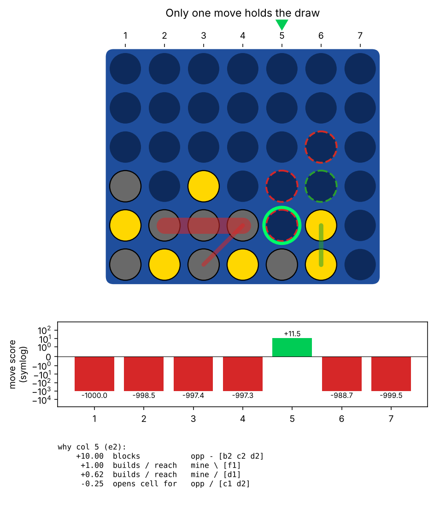

Every move except column 5 loses within a few moves. The explainer finds it here (the threat it must stop is visible as a group), but the position is drawn: nothing in the group values says so.

- group explainer: column 5 (e2), score +11.5
- exact solver: column(s) 5 - draw with best play
- the explainer agrees with the solver
